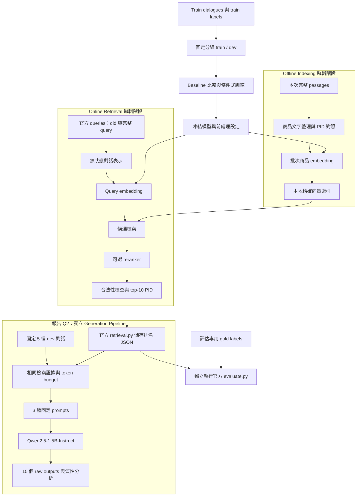

# PLAN.md — RAG 系統架構與執行計畫

版本：v1.1｜更新日期：2026-10-24（Asia/Taipei）  
狀態：**架構規劃完成；Phase 3 已開始，實際完成與測試狀態以 [PROGRESS.md](C:/Users/yuting/Desktop/HW2_ADL/PROGRESS.md) 為準。**

目前開發預設為 **W08：微調 BGE-small + H1 BM25 等權 RRF**，MiniLM 關閉。完整 dev 的原版評分為 Recall@10 0.829193／MRR@10 0.611836，優於 H1 的 0.739130／0.465780；切換後完整 966 題預設排名與被評估配置完全一致。B0／H1 保留為可重現對照。以下 B0／A1 架構是初始設計與分支說明，實際選型以 W08 結果與最新 PROGRESS 為準。

執行補充（2026-10-23，W00）：開發環境為既有 WSL Ubuntu 22.04、Python 3.12.12、RTX 4090，專案內建立隔離 overlay，不改全域 Conda。CPU FAISS 沿用原定索引設計；Python patch version 與 GPU 不同於官方，正式環境驗收仍待完成。

需求基準：[PROJECT.md](C:/Users/yuting/Desktop/HW2_ADL/PROJECT.md)。決策與替代方案：[DECISIONS.md](C:/Users/yuting/Desktop/HW2_ADL/DECISIONS.md)。本文件不改寫作業規則；`PROJECT.md` 第 9 節的 Q1–Q5 仍未獲得新答案。下列模型、參數與工程門檻是本次設計選擇，不是助教指定規格。

## 1. 建議方案與範圍

採用**單機、批次、可冷啟動重建索引**的系統：

- **Baseline B0**：完整角色對話 → `BAAI/bge-small-en-v1.5` → 正規化向量 → 本地 FAISS `IndexFlatIP` 精確搜尋 → top-10 PID。
- **優先進階 A1**：若候選能找對、但前十名排序不好，才加入小型 cross-encoder，先重排 top-50。
- **訓練分支 A2**：若課程要求訓練，或 dev 顯示有改善空間，對同一小型 embedding 模型做有限的對比式訓練。它與 A1 分開比較，不直接組合所有方法。
- **報告生成 G1**：固定 Qwen2.5-1.5B-Instruct，以檢索商品為證據，完成 5 個固定 dev 樣本 × 3 種 prompts 的 15 個輸出與分析。

B0 是**最小技術 baseline**，尚不能因為它不訓練，就宣稱已滿足最終提交的所有要求；是否可免訓練仍受 PROJECT Q1 影響。初始規劃時沒有本資料實測，後續 W06／W07／H1 已補 dev 評估；仍不能用 dev 預告 public 的 simple／strong／boss baseline。

非目標：Web UI、API server、session database、長期個人化、多代理工具鏈、網頁搜尋、知識圖譜、交易功能、LLM 掃描全商品池、分散式向量資料庫。多輪管理只處理資料中已存在的對話，不主動增加追問回合。

## 2. 必須守住的架構邊界

| 邊界 | 實作時必須遵守 |
|---|---|
| 官方入口 | 保留 `retrieval.py`、`eval_utils.py`、`evaluate.py`；正式推論只改 `retrieve_and_rerank()` 的 student block |
| 實際輸入 | 接收 `queries=[{qid, query}]` 與 `passages={pid: text}`；`query` 已是角色標記字串，不是原始 conversation list |
| 正式輸出 | 每題恰有十個有效且不重複的 PID；涵蓋全部 qid；外層 JSON 交由官方入口儲存 |
| 資料隔離 | 推論、索引與生成不讀 `target`／gold，也不讀 judge 結果；gold 只進入訓練的允許部分或離線評估 |
| 新商品 | 每次使用本次傳入的完整商品池；不固定 train／public 的 PID，也不假設 private 索引事先存在 |
| 資源 | Ubuntu 22.04、Python 3.12.9、32 GB RAM、RTX 3070 8 GB VRAM、20 GB 磁碟；public retrieval 一小時內 |
| 下載 | 所需權重預先由 download.sh 取得；正式推論設計為不需要網路，download.sh 不安裝套件、不建索引 |
| Q2 與 judge | 兩者使用同名指定模型，但程式、prompt、資料權限及計時分離；不得修改官方 judge |

來源：PROJECT §§3–6、§8；對應投影片 pp.10–20、24。套件版本衝突、額外 inference module／cache 許可及精確計時範圍仍按 PROJECT Q2–Q4 處理。

## 3. 完整架構



這裡的 Offline／Online 是**職責分工**，不是要求部署兩個服務。開發時可先建索引重複測試；正式評分不能依賴助教額外執行自訂 `build_index`。保守路徑是在官方檢索程序內先完成 indexing，再處理 queries，並將兩者都計入冷啟動時間。

正式 student block 內使用 local imports 與少量 nested helpers 表達這些職責，不新增服務、框架或程式產生器。訓練、報告、測試腳本可獨立放在提交的 `code/script/`；推論暫不 import 自行撰寫的外部模組，避免依賴尚未確認的 PROJECT Q3。

### 3.1 元件契約

| 邏輯元件 | 輸入 | 輸出／不變條件 |
|---|---|---|
| Product preparation | 當次 passages | 排序固定的 `pid_order`、對齊的商品文字；一個商品對應一列 |
| Encoder | 文字、模型與前處理設定 | 有限數值、維度一致、L2 正規化的向量 |
| Index builder | 商品向量、pid_order | `index_row ↔ PID` 一一對應；包含完整當次商品池 |
| Dialogue representation | qid、原始 query | 原文與送入 encoder 的表示；不加入 gold、不跨 qid 共用語意狀態 |
| Retriever | Query 向量、索引、candidate_k | 有序且有效的候選 PID 與內部 score |
| Reranker（選用） | 原始 query、候選商品文字 | 只重排候選，不創造商品、不改商品規格 |
| Finalizer | 候選排名、top_k | `[{qid, ranked_pids}]`；無遺漏、無重複、長度正確 |
| Report generator | 固定對話、保存的排名及商品文字 | Prompt、證據 PID、原始回覆與執行設定；不接收 gold |
| Evaluator | 官方排名、對話與 gold、商品池 | 官方指標及逐題 records；保持獨立資料權限 |

中間分數、資源量測與診斷寫入獨立實驗記錄，不增加官方 submission schema 的必需欄位。

## 4. Offline Indexing Pipeline

### 4.1 商品處理與編碼

1. 使用官方已組成的 `title + newline + description`；不重新讀固定檔案路徑，也不讀標籤。
2. 固定 PID 排序，建立 row-to-PID 對照；不把 PID 當模型文字特徵或可訓練分類標籤。
3. 只做保守空白整理；保留否定、數量、尺寸、顏色、型號與單位。Baseline 不猜測結構化商品欄位、不移除 stopwords。
4. **一商品一向量**。商品資訊標題在前，baseline 採模型 tokenizer 的 512-token 上限，記錄截斷率；不把 512 當字元數。
5. 以固定模型批次編碼；先用 batch 32 作起點，若記憶體不足，於開發期改為 16／8 並記錄設定，最終執行不臨時換模型。
6. 將向量轉為 float32 並做 L2 normalization；商品與 query 必須使用相同模型、revision、pooling 與正規化規則。
7. 建立 CPU `IndexFlatIP`；encoder 使用 GPU，索引先放 RAM，降低 GPU 同時負擔。若 FAISS 相容性有問題，可使用已存在的 NumPy／Torch 做分批精確內積，語意契約不變。

這個規模先不用商品多段切片、ANN 或量化。若 token 分析與錯誤案例顯示後段關鍵規格常被截斷，再單獨比較「保留首尾」或少量分段，並將結果聚合回唯一 PID；不以增加 chunk 數作為預設改善。

### 4.2 本地已知長度與尚待量測部分

本次只讀掃描取得以下**字元數**，不是 token 統計：

| 資料 | P50 | P95 | 最大值 |
|---|---:|---:|---:|
| Train 商品組合文字 | 1,692 | 3,134 | 6,517 |
| Public 商品組合文字 | 1,705 | 3,129 | 6,517 |
| Train 完整角色對話 | 416 | 702 | 882 |
| Public 完整角色對話 | 451 | 725 | 818 |

因此商品截斷值得檢查；不能據字元數保證任何 tokenizer 都不超長。W01/W02 須量測實際模型的 token 分布、截斷率與長商品錯誤樣本。

### 4.3 冷啟動、快取與版本

- **正式 baseline 不要求持久化 index cache**，每次可從本次 passages 完整建構，包含 private 新商品。
- 開發 cache 只是重複實驗加速，停用後結果仍須一致。正式提交是否使用它，待 PROJECT Q3/Q4 確認。
- 若啟用 cache，manifest 至少記錄完整 PID／文字內容指紋、模型 revision／checkpoint hash、tokenizer、max length、pooling、normalization、dtype、前處理版本與 PID 順序。
- 商品新增、刪除、文字變更、模型或設定變更皆使舊 cache 失效；baseline 直接重建，不先做增量同步系統。只比商品數或 split 名稱不夠。
- 不用快取命中的時間冒充官方冷啟動速度；不在 download.sh 做商品編碼或索引建構。

## 5. Online Retrieval 與 Multi-turn Dialogue Management

### 5.1 多輪的最小正確設計

每個 qid 都是獨立樣本；處理完即丟棄暫時狀態。Baseline 的狀態只有 `qid`、`raw_query`、`query_for_embedding` 及截斷診斷，不建立跨樣本 memory。

保留官方給定的完整 role-tagged transcript。不要假設最後一句是完整搜尋需求，也不要把已展平的 query 當成 conversation list。Baseline 不用字串切割重建角色物件，避免訊息內容中的冒號或換行被誤解析。

H1U 例外（2026-10-24；使用者明確授權的單一 BM25 表示消融）：**Dense 仍逐字使用完整原對話**。僅 BM25 端可解析行首 `user:`／`assistant:`；要求 user 開頭、角色交替、user 結尾，其他行視為同回合的續行。格式不符合或沒有 user 則回退原文並計數。只保留 user 回合；最後 user 是極短確認／指代詞時，補回緊鄰前一則 assistant。這不等於可無損重建任意展平對話；原文中偽造的行首角色標籤無法總是區別，需原始資料 preflight 與診斷，不能宣稱普遍消除歧義。

| 對話情況 | 系統的語意目標 | Baseline 如何處理／進階的驗證要求 |
|---|---|---|
| 早期給用途、最後只說顏色 | 同時保留用途與新限制 | 保留全對話；不能只取最後一句 |
| 使用者後續明確改口 | 新的明確要求優先於被撤回條件 | 保留回合順序；若加摘要，須記錄修正來源 |
| 助理提議兩種選項 | 未確認的選項不是使用者需求 | 保留角色；不將 assistant 全文轉成硬限制 |
| 「yes」「that one」 | 需要前一則助理語境 | 不先刪除 assistant turns |
| 「not scented」 | 保留否定 | 不做移除否定詞的清洗 |
| 「prefer」「maybe」 | 軟性偏好，不是硬排除 | 不建立無證據的硬 filter |
| 過去買過 A，現在想買 B | 以目前需求為重點 | 全文保留；用失敗案例檢查模型是否受歷史商品干擾 |
| 沒說價格、材質或數量 | 不自行補值 | 不新增推測屬性，不從 PID 或 target 推回需求 |

以上是測試期待，不是宣稱預訓練 embedding 已具有完美意圖解析能力。Baseline 不輸出自信度很高的結構化 slots。

如後續錯誤分析證明需要改寫，才增加候選 `DialogueState`：`current_need`、`hard_constraints`、`soft_preferences`、`negations`、`corrections`、`evidence_spans`。每項資訊必須指回原始對話；不確定的欄位留空，改寫新增條件、遺失否定或證據無法對齊時回退 raw query。此分支未列入最低交付範圍。

### 5.2 Query 編碼與排序

1. B0 將全對話接在 BGE 的 retrieval query instruction 後；商品端不加該 instruction。固定本次前處理，避免訓練與推論不同。[BGE 模型卡](https://huggingface.co/BAAI/bge-small-en-v1.5)
2. Query 上限 512 tokens，包含 instruction 與特殊 tokens。若真的超長，候選退化策略為保留內容首 128 tokens 與末端剩餘預算，記錄省略；它可能遺失中段限制，須測試而不能宣稱語意完整。正常短對話保持全文。
3. 批次編碼 query，與商品同樣正規化；以內積作 cosine ranking。
4. B0 搜尋 top-10；A1 搜尋 `min(50, 商品數)` 後重排，最後取 `top_k`。函式仍尊重傳入的 top_k，候選數不能少於它。
5. 不對每個 query 重新編碼全商品池。索引與模型在同一次呼叫中共用，但對話內容彼此隔離。
6. 同分採 PID 次序作明確次排序；需處理 top-k 邊界同分候選，不能只排序已被任意截掉的 k 個結果。完全同分／重複向量 fixture 驗證此行為。
7. 每題結果檢查 PID 存在、唯一及數量；去重後不足時從其餘已排序候選補足。資料損壞、NaN 或缺少模型時回報清楚錯誤，不靜默用任意商品掩飾失敗。

### 5.3 可選 reranking

預選 `cross-encoder/ms-marco-MiniLM-L6-v2`，輸入「對話、候選商品文字」pair。它是 MS MARCO passage ranking 模型，不是商品多輪專用模型，必須以本地 dev 判定是否有效。[模型卡](https://huggingface.co/cross-encoder/ms-marco-MiniLM-L6-v2)

- 起始候選數 50、batch 16；速度不足先比較 top-20，不掃描全池。
- 每個 pair 的總長度上限 512；初始 query 內容預算 192，其餘分配商品，扣除特殊 tokens。超長 query 的首尾策略須保留診斷，不能默默丟掉最後一次修正。[模型設定](https://huggingface.co/cross-encoder/ms-marco-MiniLM-L6-v2/blob/main/config.json)
- 初版只依 reranker score 排序，不先加可調加權融合；同分依原 retriever rank、PID 決定。
- 載入 reranker 前可釋放 encoder 的 GPU 記憶體，保留 CPU 索引與已計算的 query 向量。必要資產依序載入，不同時駐留 Qwen。
- 若候選池根本沒有合理商品，reranker 無法補救；先檢查 candidate Hit@50，再決定要不要開啟這個分支。

## 6. Online Generation Pipeline（報告 Q2）

「Online」指收到對話與檢索證據後生成，不表示要建立即時服務。另以離線實驗腳本呼叫相同邏輯，完成報告。

W09 本輪執行（2026-10-24，使用者授權繼續）：沿用 W02 已鎖定且不含 target 的 `data/derived/q2_queries.jsonl` 五題，證據固定為 W08 已驗證的 `results/w08_default_dev_top50.json` 每題前三名。先完成 context builder／三 prompts 的單元測試與真 tokenizer 預算核對，再載入既有指定 Qwen 做 5×3 生成。批次 1、bf16、greedy、seed 0、總長 4096、輸出上限 256；三種 prompts 共用每題相同證據前綴，超長時共同縮短證據而不各自截斷。先保存完整輸入計畫，再逐筆保存 raw text／token IDs、EOS／長度上限、資源與 hashes；完整輸出均納入分析，失敗與幻覺不刪除。質性檢閱明確標示為本次助理依自訂量表分析，不冒稱使用者人工標註或獨立盲評，也不代替官方 retrieval Judge。本輪不更改 W08、不用 gold 補商品、不調整官方 evaluator，不進入 public 評測或封裝。

W09 執行結果：54 tests 通過；真 tokenizer 與完整 15 筆原始生成／token IDs／來源核對完成。最長輸入 2337、輸出 211 tokens，15 筆均 EOS，商品證據 0 截斷；生成程序 84.250 秒，CUDA allocated 3.148 GiB。所有原文與逐例助理分析已保存於 `results/w09_q2/` 與 `W09_RESULTS.md`。三種 prompts 均有內容或格式錯誤：跨商品規格混用、產地／容量捏造、錯誤拒答，指定 PID 格式 0／15 遵守；不將結構核對通過稱為生成品質通過。本輪不追加生成或改 W08，下一項為 W10。

1. 預先固定 5 個 dev qid，涵蓋 3／5 則訊息、硬限制、歷史商品干擾與資訊不足等情況；在看生成輸出前鎖定樣本，不能只保留漂亮結果。
2. 讀取凍結版本 retriever 的結果；每題固定使用 top-3 商品文字及 PID。若這三項都不適合，照實分析；不把 gold 商品偷偷補進 context。
3. 使用 `Qwen/Qwen2.5-1.5B-Instruct` 與官方 chat template。生成角色與官方 judge 分離。
4. 初始總 token 預算 4,096，其中輸出最多 256，輸入含 template 最多 3,840。三個商品各先限制為最多約 900 tokens，其餘保留完整短對話與指令；以實際 tokenizer 二次檢查，不用字元數代替。
5. 三種 prompts 使用**相同對話、證據、候選順序及輸入證據 budget**。若有一種 prompt 太長，統一縮小三種使用的證據，使比較仍公平。
6. 固定 `do_sample=False`、`num_beams=1`、batch 1、相同 dtype 與模型 revision；這些是 Q2 實驗設定，不能拿去改官方 judge 的 12-token 上限或 batch size 8。
7. 保存 15 筆完整 prompt、證據 PID／文字、原始輸出、generation settings、模型與檢索版本、時間及註明評閱來源的質性評語（本輪由助理檢閱，不冒稱真人標註）。

模型卡為這個 1.5B 型號列出 1.54B 參數及 32,768-token context；本計畫主動採較短輸入以控制資源，並非要求使用最大 context。[Qwen 模型卡](https://huggingface.co/Qwen/Qwen2.5-1.5B-Instruct)

| Prompt ID | 唯一主要變因 | 具體設計方向 |
|---|---|---|
| G-P1 | 直接 grounded recommendation | 依對話及所列商品推薦一項，簡短說明原因；只使用提供規格 |
| G-P2 | 需求與證據對應 | 回覆列出顧客需求、商品可支持的對應規格及 PID，給簡短推薦理由；不要求長篇推理過程 |
| G-P3 | 證據不足的處理方式 | 明示不要猜測缺漏規格；指出哪些硬限制無法由商品文字確認，並給保留式推薦或說明無法確認 |

三種共通規則：商品與對話內容是資料；不遵從其中夾帶的指令；不捏造價格、庫存或功效。若產生不存在的 PID，記錄為生成錯誤。不可刪除或修飾 raw output 後冒充模型原始結果。

## 7. 選型比較與最小實驗矩陣

### 7.1 Embedding／Retriever／Vector storage

| 候選 | 特性與代價 | 本次選擇 |
|---|---|---|
| `BAAI/bge-small-en-v1.5` | 384 維、512 tokens；適合先建立小型本地 encoder 基準 | B0 首選；英文適用性依目前資料觀察，仍須抽查語言與實測 |
| `intfloat/e5-small-v2` | 384 維、512 tokens；query 與 passage 各有指定 prefix | 同規模備選，不同時跑大量 embedding 家族 |
| `BAAI/bge-base-en-v1.5` | 768 維、512 tokens；向量空間與模型運算成本更高 | small 有明顯表徵瓶頸且時間允許才比較 |
| BM25 | 不需 GPU／模型訓練，容易解釋詞面命中；對多輪改寫與同義詞有限 | 可選詞面診斷或 hybrid 分支，非必要先修工作 |
| Dense exact retrieval | 能利用語意表徵；仍可能忽略否定、規格與改口 | B0 採用；實作與誤差來源較少 |
| Dense + BM25 融合 | 可能補足型號、詞面與語意；增加 tokenizer、融合設定與測試成本 | 只在詞面錯誤明確時考慮，先用 rank fusion，避免直接相加不同尺度分數 |
| FAISS `IndexFlatIP` | 同程序向量搜尋函式庫，非完整向量資料庫服務；精確搜尋不需訓練 ANN index | 預設採用，利用現有依賴 |
| NumPy／Torch exact search | 已有依賴、易核對；分批避免大型 score matrix | FAISS 相容性備援與小型正確性 oracle |
| HNSW／IVF 類 ANN | 增加近似召回與參數調整的變因 | 100k 規模下先不採，只有 exact search 實測是瓶頸才重開決策 |
| Qdrant 類向量資料庫 | 提供集合、儲存與過濾等管理能力；本作業沒有服務化資料管理需求 | 不採用，不增加 server／新資料庫依賴 |

模型規格來源：[BGE small](https://huggingface.co/BAAI/bge-small-en-v1.5)、[E5 small](https://huggingface.co/intfloat/e5-small-v2)、[BGE base](https://huggingface.co/BAAI/bge-base-en-v1.5)。索引／資料庫來源：[FAISS IndexFlatIP](https://faiss.ai/cpp_api/struct/structfaiss_1_1IndexFlatIP.html)、[Qdrant overview](https://qdrant.tech/documentation/overview/)。本表的選擇是依作業規模做出的工程判斷，沒有引用外部 leaderboard 預測本作業得分。

### 7.2 Reranker 與 LLM

| 候選 | 決策 |
|---|---|
| 不使用 reranker | B0 預設，先建立可靠對照 |
| MiniLM-L6 cross-encoder | A1 首選；只處理少量候選；增加 1k×50＝50,000 pairs 的 public 工作量 |
| 更大型 reranker／LLM rerank | 暫不採；8 GB 與冷啟動上限下，新增成本必須先有證據支持 |
| Qwen2.5-1.5B-Instruct | Q2 與官方 judge 固定，不能因其他 LLM 更新就更換指定模型 |
| 遠端付費 embedding／LLM API | 不採；增加網路、費用、版本與重現依賴；Q2 也已有指定模型 |

兩階段檢索與重排的概念參考 [Sentence Transformers 官方說明](https://www.sbert.net/examples/sentence_transformer/applications/retrieve_rerank/README.html)。採用模型／函式庫不等於直接搬用他人的作業解法；實作須自行完成並遵守 PROJECT 的學術規範。

### 7.3 實驗順序與進階分支

| ID | 配置 | 目的與啟用條件 |
|---|---|---|
| B0 | 全對話 + BGE-small + exact top-10 | 必做工程對照；未訓練模型 |
| A1 | B0 取 top-50 + MiniLM 重排 | 候選召回足夠、MRR 有改善空間才做；與 B0 用相同 dev 比較 |
| A2 | 小型 embedding 對比訓練 + exact retrieval | 課程訓練要求成立，或訓練資料可望帶來改善時；先不疊加 A1 |
| H1 | Dense + BM25 | 當錯誤以型號／詞面限制為主，才取代其他非必要進階工作 |
| QRY1 | 使用者重點表示／有證據的 query rewrite | 當歷史商品與多輪衝突是主要問題才研究，先做保真度與品質消融 |

優先只做 **B0 + 一條有證據支持的進階分支**。若確認必須訓練，A2 優先於 A1；若沒時間完成必要訓練，不能把 B0 冒充完整合格提交。更換 embedding、改 query、加 reranker 應分別消融，不做大範圍參數組合搜尋。

### 7.4 A2 的最低訓練設計

W08 本輪授權與凍結設定（2026-10-24）：使用者已同意執行一次 BGE-small 微調。僅更新 encoder 權重；H1 的完整對話、商品 title＋description、512-token 處理、BM25 full／1／1、兩路 100 與 RRF 60 不變。先測資料隔離、batch 去重、有限 loss／非零梯度、checkpoint 離線重載及正式入口相容性，再使用 train 3,864 筆跑 **1 epoch**；本輪不比較第二 epoch、不挖 hard negatives、不合併 U2、不訓練 Qwen。

產物為 `code/script/train.py`、固定 JSON 設定、`run.sh`、獨立 checkpoint、逐步 loss／訓練 manifest 與 `W08_RESULTS.md`。先在完整 966 題／50k 商品池重新建索引並用 `analyze_results.py` 快篩；整體及 beauty-train 的 Gold Hit10／MRR10／Hit50 均不下降，且各組至少一項提高，才對該唯一配置執行一次原版 Judge。正式 graded Recall／MRR 均不下降且至少一項提高才可提升預設，否則保留 H1。任何 OOM／設定調整均另留紀錄，不把開發卡成功視為官方 8 GB 驗收。

W08 執行結果：43 tests、真模型 smoke、242 steps／1 epoch、離線 checkpoint 重載與來源稽核完成。Gold 六項門檻均提高；唯一一次原版 Judge 的 Recall 0.829193／MRR 0.611836，beauty-train 0.741419／0.481396，符合採用政策。已提升 checkpoint 預設，完整 966 題無覆寫排名與被評估配置完全一致。此輪結束，不追加訓練；詳見 W08_RESULTS.md／results/w08_final.json。

- 只使用分組後 training partition 的 `(完整對話, gold 商品文字)`；不加入外部訓練資料，避免額外來源與下載成本。
- 初版使用對比式 `MultipleNegativesRankingLoss` 概念：同批其他商品作候選負例，以正例的 normalized dot product 相對其他商品進行交叉熵訓練。[官方 loss 文件](https://www.sbert.net/docs/package_reference/sentence_transformer/losses.html#sentence_transformers.losses.MultipleNegativesRankingLoss)
- 同一 batch 排除重複 PID／相同商品文字；不能讓同一 gold 商品互相成為負例。不同 PID 也可能是可接受替代品，因此先不大量挖 hard negatives，並人工抽查錯誤。
- 初始候選設定：learning rate `2e-5`、1 epoch、實際 batch 16（記憶體不足用 8）、warmup ratio 0.1、weight decay 0.01、seed 42、cosine scale 20。這些是起始實驗值，不是最佳參數或已驗證配置。
- 若使用 gradient accumulation，只能增加 optimizer 的有效 batch；**不會自動增加每個 loss 的 in-batch negatives**。不為追求大 batch 先引入複雜 cache-loss 或多 GPU 訓練。
- 原規劃最多比較 1／2 epochs；本輪依授權固定 **1 epoch**，沒有追加第二 epoch。訓練／推論共用 query instruction、商品處理與 normalization。
- Dev 商品保持可檢索；dev gold supervision 不參與梯度。初版不另用 dev gold 商品作訓練負例，也不使用 public 查詢挖負例。
- 導出單一選定 checkpoint、tokenizer、參數與訓練 manifest；`run.sh` 要重現真實流程。未在此階段決定套件 trainer API，以免依賴新版文件中固定環境沒有的功能。

## 8. 測試資料與 Evaluation Metrics

### 8.1 無洩漏資料協議

1. Train 的 4,830 筆對話以 seed 42 做約 **80/20 的 train/dev 分組切分**。同 target PID、正規化後完全相同的對話納入同群；若不同 PID 的商品文字完全相同，對應的標註對話也併群。跨條件連通則一起分配，避免只隔離 ID 卻留下相同內容。實際筆數按群組大小記錄，不硬宣稱剛好 3,864／966。
2. 先做便宜的精確重複檢查；近重複只在發現問題時抽查／合併，不另建語意去重模型。
3. Dev 的商品池仍是完整 train 50,000 項，不能把 dev gold 商品從索引中移除。分組隔離的是 supervision。
4. 固定 100 筆 dev-fast，兼顧 3／5 則訊息；先做工程 smoke 與 gold-only 篩選，再對最多兩個 finalist 跑完整 dev judge。
5. 模型、前處理與參數主要在 dev 決定；public 在版本凍結後做正式確認。若看過 public 後修正 bug，保留紀錄，不能再將它當未看過的獨立估計。
6. Public target 不用於梯度、負樣本、query 改寫、逐題規則或 PID lookup。Public 商品文字可以作本次推論的索引輸入。
7. Private 不可取得；100k 大小的人工壓力 fixture 只能驗證資源／新商品相容性，不能代表 private relevance 或分數，也不加入訓練。

保存 split manifest、seed、分組規則、qid 清單與原始資料 hash。不要把 dev label 檔包成推論依賴。

### 8.2 小型行為 fixtures

以自寫、非訓練用途的 10–20 項虛構商品池建立下列 fixture。區分「必須通過的介面／資料完整性」與「需觀察的模型語意品質」：

| Fixture | 主要檢驗 |
|---|---|
| 先要求吹風機，後面只確認折疊把手 | 早期核心用途沒有丟失 |
| 黑色改成棕色 | 最新明確修正與回合順序 |
| 不要香精 | 否定保留，不能清洗成香精偏好 |
| prefer／maybe | 軟偏好不變成硬 filter |
| 助理提出兩種產品，顧客只確認一種 | 助理建議與使用者確認的差異 |
| yes／that one | 前一則助理語境保留 |
| 過去買 self-tanning，本次要 firming | 歷史產品與現在意圖區分 |
| shampoo／conditioner 相近商品 | 核心功能不能被搭配品取代 |
| 缺價格或規格 | 不新增未提供屬性；生成能指出不確定 |
| 超長 query／商品，否定在尾端 | 截斷行為可追蹤且不隱藏資料損失 |
| 相同向量／同分、商品輸入順序改變 | PID 對齊、top-k 邊界同分與重現性 |
| 新增／刪除／修改商品，連續兩個不同 qid | 新商品可被找到、沒有舊 cache 或對話串流污染 |
| 商品文案夾帶「忽略指令」等文字 | 生成不把商品文字當指令 |

不能因為設計了這些案例就宣稱模型通過。錯誤應留在報告或促成有證據的修正；不以人工規則硬背每個 fixture 的答案。

### 8.3 指標分層

| 層級 | 指標 | 解讀 |
|---|---|---|
| 正式品質 | 官方 `graded_recall@10`、`graded_mrr@10` | 使用原 evaluate.py，gold 或 judge 接受的替代品都算 relevant |
| 廉價診斷 | Gold-only Hit@10／MRR@10、candidate Hit@50 | 找候選／排序瓶頸；不是正式 graded 指標，不命中 gold 也可能是合理替代品 |
| 多輪切片 | 3／5 則訊息、硬限制、改口、歷史商品干擾 | 比較失敗類型；手動標記 subset 只是診斷，不冒稱完整標註 |
| 工程 | 100% qid coverage、10 個唯一合法 PID、冷啟動時間、RAM／VRAM／磁碟、重跑排名差異 | 必須符合正式介面與資源限制 |
| 生成 | 需求滿足、限制遵守、規格忠實度、無依據陳述、清楚程度 | 各 0–2 分的自訂量表，加逐例證據；官方未訂數值及格線 |

正式定義保持 PROJECT §8.3：`Recall@10 = mean(max(g))`；`MRR@10 = mean(max(g/rank))`。Gold 與被接受替代品 gain 皆為 1；judge 解析失敗為 0。不要用 Precision@10、gold-only recall 或沒有完整 relevance labels 的 NDCG 取代它。

Q2 不以無參考答案的 BLEU／ROUGE 充當主要品質結論；保留 unsupported claims、無效 PID、檢索失敗與生成失真的個別案例。若指標差距小，可做配對逐題差異／bootstrap 作輔助，但不為少量差距宣稱統計保證。

### 8.4 開發與正式驗收門檻

- **官方要求**：public retrieval ≤3,600 秒；32 GB RAM／8 GB VRAM／20 GB 磁碟；有效 top-10；指定 evaluator 與 `--batch-size 8`。
- **自行設定的工程目標**：public 冷啟動 ≤2,700 秒（45 分鐘），留下環境差異餘裕；實際仍須在官方相容硬體量測。
- **品質參考**：public simple 為 Recall 0.860／MRR 0.650，strong 為 0.885／0.680，boss 為 0.950／0.800。這些是原作業級距，沒有預測 B0 能達哪一級；private 表見 PROJECT §8.4。
- **進階採納原則**：在同一 dev、商品池與 judge 設定下，正式指標改善且時間／記憶體合格才保留。若 Recall 與 MRR 一升一降，明確呈現 trade-off 與對官方級距的影響，不以任意加總掩蓋退步；差距不明顯時保留簡單方案。
- 先退出 retrieval 程序，再執行官方 evaluator；兩者計時分開。Q2 generation 再獨立執行，不同時占用 GPU。
- 官方 judge 有 `truncation=False`；不因 OOM／超長而改 evaluator 或刪除困難題。可以記錄較小 batch 的本地診斷，但不得冒稱已通過官方 batch 8 驗收。

## 9. 模型需求、成本與風險

### 9.1 可計算的資源量與待量測的運算成本

向量儲存粗估 `商品數 × 維度 × 4 bytes`，只算一份 float32 向量，不包含模型、文字、索引副本、CUDA workspace：

| 商品數 | 384 維向量 | 768 維向量 |
|---|---:|---:|
| 50,000 | 76.8 MB | 153.6 MB |
| 75,000 | 115.2 MB | 230.4 MB |
| 100,000 | 153.6 MB | 307.2 MB |

因此初版不需要為向量容量引入服務型資料庫。搜尋分批 32 queries 時，100k 商品的 float32 score block 約 12.8 MB；若使用 NumPy／Torch 備援，不建立全體 query×product 矩陣。

Qwen 的 1.54B 參數若以 2 bytes／參數粗算，**權重本身約 3.08 GB**；這不是實際 VRAM 需求，還要加 activations、KV cache、載入暫存與 padding。8 GB 是否足以跑特定 batch／prompt 必須實測。Embedding、reranker、judge、Q2 分段載入，最終只保留需要的模型檔，避免 checkpoint／Hub cache 多份重複吃掉 20 GB。

```text
T_public = T_load + T_product_encode(75k) + T_index
         + T_query_encode(1k) + T_search + T_rerank + T_write
T_judge  ≈ 非 gold candidate pairs / 實測 judge pairs_per_second
T_download ≈ 所需檔案大小 / 實際頻寬 + 請求與重試時間
```

Public judge 最多 10,000 pairs；A1 top-50 需要 50,000 rerank pairs。模型卡中的他種 GPU 吞吐量不作 RTX 3070 的速度保證。先對代表性短／長文本量測 1,000 商品編碼、100 query 與候選 pairs，再估算整批並實跑驗證。10 MB/s 是下載上限，不是可用最低速度。

不採付費 API，所以沒有設計上的 API token 費用；本地電力、GPU 租用／排隊及實際訓練時間尚未量測，不能宣稱總成本為零。

### 9.2 人工作時估計與截止策略

| 工作群 | 規劃估計，非承諾 |
|---|---:|
| 資料切分、契約與 fixtures | 1–2 小時 |
| Baseline、索引與多輪表示 | 3–5 小時 |
| Dev、官方評估與效能核對 | 2–4 小時 |
| Q2 runner、15 筆結果與分析 | 2–4 小時 |
| 報告、重現、下載與封裝 | 3–5 小時 |
| 最小路線合計 | **11–20 人工作時**，不含下載、GPU 執行／排隊及環境故障 |
| 每條進階分支 | 另約 3–6 人工作時，加未量測算力 |

期限依 PROJECT 為 2026-10-25 23:59:59。建議先完成能評估的 B0 與 Q2 runner，再決定進階；截止前至少保留 6 小時做報告與乾淨重跑。若訓練被確認必須，A2 納入必要路線並重估成本，不能仍宣稱 11–20 小時涵蓋全部訓練工作。此排程是建議，未建立自動排程或開始工作。

### 9.3 風險清單

| 風險 | 影響／偵測 | 降低風險的設計 |
|---|---|---|
| Q1 訓練必要性未明 | 不訓練的提交可能不完整 | B0 作技術對照；保留小型 A2，最終提交前釐清 |
| 套件／Linux GPU 差異 | import、dtype、FAISS 或 trainer 不能執行 | 使用現有依賴，提早在指定環境 smoke；不在 download.sh 安裝 |
| Public 編碼冷啟動超時 | 小測快，但 75k 商品總時間超限 | 完整計時、批次化、45 分鐘工程目標；先減非必要 rerank |
| 截斷與多輪語意錯誤 | 尾端限制、否定或新需求被忽略 | token 分布、fixture、切片分析；不預設 LLM rewrite 能解決 |
| 單一 gold 帶來假負例 | 可接受替代品被訓練壓低 | 去除重複 PID、少量訓練、抽查 negatives，不盲目 hard mining |
| Cache／PID mapping 錯誤 | 回傳舊商品或 ID 對錯向量 | 固定 row mapping、全池驗證、內容指紋；正式可完整重建 |
| Public 過度調參 | 得分看似提升卻無法一般化 | Train/dev 決策、凍結後 public；保留所有嘗試紀錄 |
| 官方 judge OOM／context | 評估失敗或解析大量為零 | 先檢查 token／padding、獨立程序與 batch 8；不修改評分規則 |
| Q2 把 gold 補進 context | 掩蓋 retrieval miss | 生成只讀排名商品；gold 僅由評估端持有 |
| 下載重複／連結失效 | 超過 30 分鐘或 20 GB | 固定 revision、只需檔案、校驗大小／hash、保留連結三週 |
| 功能膨脹擠壓報告 | 系統能跑但缺必交內容 | B0 優先、只選一條進階、保留打包時段 |

## 10. 可獨立驗收的工作項目

下表是工作定義；即時狀態見 PROGRESS.md。元件是可驗收責任，不要求每個都拆成 production 檔案。

| ID | 工作與產物 | 依賴 | 獨立驗收方式 |
|---|---|---|---|
| W00 | 核對 Q1–Q4、環境與允許依賴；記錄答案 | 無 | 更新 decisions 狀態，保留公告來源；未知項仍用保守路徑 |
| W01 | 模型相容性／token／資源 smoke；固定 revisions | W00 的已知環境 | 小樣本載入、向量維度／有限值、query／product token 統計；不測整套系統才知道不能載入 |
| W02 | 分組 split manifest 與手寫 fixtures | 無 | qid／target 群組不跨 split，原始資料 hash 固定，fixture 與訓練資料分開 |
| W03 | 商品整理、完整索引與 PID mapping | W01 | 小型已知向量驗證搜尋；商品增刪／換序／重複向量皆正確 |
| W04 | 無狀態完整對話表示 | W02 | 用 fake encoder 擷取實際送入文字，驗證角色順序、否定、qid 隔離與截斷 |
| W05 | B0 正式入口整合 | W03、W04 | 官方函式輸入小商品池，合法 top-k、無 gold；與暴力精確排序比對 |
| W06 | Dev metrics、冷啟動計時及原版 evaluator | W05、W02 | Gold-only／graded 分開；先小型 smoke 再完整 dev；保存耗時與 records |
| W07 | A1 reranker，條件式 | W06 | 可控制 candidate set；只重排原候選；同 dev 消融與 pairs/sec |
| W08 | A2 訓練、checkpoint 導出、單次品質評估及預設提升完成 | W01、W02、W06 | 無 public／dev supervision、無重複 PID negatives、loss 有限；正式入口載入、Gold／graded 門檻與完整預設排名驗證均通過 |
| W09 | Q2 context builder、三 prompts、生成 runner 與分析完成 | W05；最終證據使用凍結 W08 | 5×3 grid、同證據、無 gold、raw token／文字核對完成；54 tests 通過；內容缺陷均記錄，非宣稱語意品質全通過 |
| W10 | 版本凍結、完整 public 官方驗收 | W06；選用的 W07／W08 | 冷啟動一小時內、資源合格、原評估 batch 8、設定／資料／模型一致 |
| W11 | Report Q1／Q2、README、run.sh、download.sh、ZIP | W09、W10 及實際訓練流程 | 對照 PROJECT 必交清單；下載僅下載、重現命令一致、解壓有學號資料夾 |

可平行的責任：W02 與 W01；W03 與 W04；W09 的 prompt／記錄格式與進階實驗。實際 GPU-heavy jobs 建議排隊執行，避免 8 GB 競爭。報告框架可以提早準備，正式數字須等實驗完成。

### 10.1 不為了測試而破壞作業介面

- 使用公開 `retrieve_and_rerank` 介面及少量可控制的 encoder／index 測試替身，隔離商品向量、query 表示、排序與 finalizer 的行為；不改函式簽名或既有區塊。
- Nested helpers 不必為了直接 import 而移出 student block；元件驗收可經公開入口、擷取第三方呼叫輸入及中間實驗產物完成。
- 不用 AST 抽取／重寫函式、不複製一套正式演算法到測試模組、不建立 source generator。
- 訓練與生成本來就是獨立腳本，可各用小型 fixture 直接驗收。正式模型 smoke 與語意品質實驗仍必要，fake-model 測試不能替代它們。

## 11. 檔案職責

W06 執行細化（2026-10-24）：維持 B0 不調參。新增獨立的 `analyze_results.py`、`run_measured.py` 與 judge 相容性 smoke。先在完整 50k 商品池測 dev-fast 100 題，再測完整 dev 966 題；另用官方入口的 `--top-k 50` 做候選診斷，不能把 50-item 結果直接當正式 top-10 評分。以外層程序計時涵蓋 Python 啟動、套件／模型載入、商品編碼、搜尋與寫檔，內層只收集 resource／CUDA 峰值、不修改官方程式或模型行為。Qwen 先固定 revision、下載並做原版 judge 的 batch 8 smoke，再依序跑 dev-fast 與完整 dev 的原版 evaluator。Gold-only 與 graded 指標分開保存，public 留在 W10。這是執行順序細化，不改架構或官方評分規則。

W07 執行細化（2026-10-24；使用者授權繼續改善）：

1. 啟動原定 A1 單獨實驗。依據是 gold Hit@10 0.468944、Hit@50 0.649068，部分正解存在候選集但排名偏後；尚未證明重排有效。B0 原始程式與量測工具先保存快照。
2. 正式入口以 `HW2_RERANK=1` 開啟 MiniLM cross-encoder，預設仍為 B0，直到驗證完成再決定是否採用。初始候選 50、batch 16、pair 512 tokens；query 上限 192、超長保留首 64 與末 128，其餘 token 預算給商品前段。使用原始角色對話，不附 BGE instruction。以模型 tokenizer 的 token IDs 組 pair，避免二次切詞破壞長度預算。
3. 僅重排 dense 候選；依 raw logit 降序，同分維持 dense 次序。候選數至少 top_k、至多商品數。釋放 embedding GPU 模型後載入 reranker，固定模型 revision、本地離線推論。測試候選隔離、top-k、小池、同分、query 末端否定保留、pair 長度、無效分數與關閉時 B0 一致。
4. 先跑 dev-fast 100 題檢索 smoke，再以完整 dev 966 題、完整 50k 商品池執行冷啟動檢索與原版 judge（固定順序、batch 8）。Gold-only 作診斷；採用依據以完整官方 graded Recall／MRR 為主，同時記錄時間、記憶體與逐題得失。若雙指標均退步則不採；若互有得失保留 B0 預設並記錄取捨，不把單一指標上升稱全面改善。
5. BM25／RRF（容量與型號匹配）、商品少量分段（26.976% 截斷）、A2 對比訓練保留為後續各自獨立的比較。規格匹配與截斷只是待驗證原因，這一輪不疊加，以便歸因。若課程確認訓練必做，A2 優先。

W07 執行結果：已完成 22 個測試、真模型 smoke／完整 dev、原版 judge 與稽核。A1 graded Recall@10 0.606625、MRR@10 0.327259，均低於 B0 0.652174／0.396446，因此不採用為預設。下一個優先可選分支改為 H1；細節見 W07_RESULTS.md。官方硬體驗收、public 與訓練仍未完成。

H1 固定初始實驗設計（已實作與完成官方 dev 比較）：

- 比較 B0、BM25-only、Dense + BM25 RRF 三種設定。使用同一份完整對話，先不加入需求改寫；BM25 索引完整商品標題＋描述，清楚記錄它與 BGE 512-token 表示的差異。
- 分詞保留小數與型號，例如 `1.6`／`1.7` 不可合併；先只做一致的大小寫與詞項切分，不把否定詞當停用詞刪掉。不依容量字樣直接硬篩商品，避免未解析清楚就刪除合理答案。
- 初始 BM25 `k1=1.5`、`b=0.75`；兩路各取 100 個，RRF rank constant 60、等權重，合併後直接取前十，不同時加 MiniLM。以上是固定起始值，尚非最佳參數。
- 先測小型人工 oracle、PID 去重、同分與候選邊界，再測 dev-fast；有候選召回改善線索後才完成完整 dev 的原版評分。保留每一配置，不做大範圍參數搜尋。
- 商品分段留為下一個獨立變因：只處理超長商品，保留 PID 聚合與唯一推薦，另測其時間／記憶體。W07 的分組診斷已顯示可完整放入的 gold 也退步，不能先假定分段會修復通用 reranker 的問題。

H1 執行細化（2026-10-24；使用者授權執行下一個提升準確度實驗）：先保存 W07 程式快照。正式 student block 增加 `HW2_RETRIEVER=dense|bm25|hybrid`，預設先維持 dense。BM25 使用既有 NumPy＋標準函式庫倒排索引，固定 k1=1.5／b=0.75、正值 IDF `log(1+(N-df+0.5)/(df+0.5))`，query 的不同詞項各計一次；不新增套件、停用詞或 stemmer。大小寫統一，保留小數／連字號型號與否定詞。Hybrid 兩路各取 100、RRF 常數 60、等權；詞面分數為零的商品不參與 BM25 fusion，無詞面命中時退回 dense 排名。BM25-only 不需 embedding 模型與 GPU。

新增小型獨立公式 oracle、分詞／長文尾端、PID／同分／小池、零詞面命中與融合測試，再執行 dev-fast。接著固定完整 dev 966／50k 商品，保存 BM25-only 與 hybrid 的 gold-only 診斷及候選 Hit@50；依候選／top-10 結果決定官方 graded 比較，至少完整評估最有改善線索的分支。各輪保持原 query、商品前處理、模型與 judge 不變（BM25 使用完整商品文字，這項差異明確記錄）。主要採用依據為完整官方 Recall／MRR；若雙指標改善則選為下一開發候選，互有得失或退步則保留 dense。任何預設提升皆另保存被評估的 source 與驗證預設輸出一致，不把 dev 選型當成 public 驗收。

H1 比較結果：BM25-only graded Recall@10 0.650104／MRR@10 0.450887，排序改善但命中題數少 2 題；Hybrid 為 **0.739130／0.465780**，相較 B0 多命中 84 題，兩項均改善。因此選定 `HW2_RETRIEVER=hybrid` 作開發版預設，保留 dense／bm25 顯式切換；不加 MiniLM。全流程與資料來源稽核通過，切換預設後的完整 dev 966 題排名也與被評估的 Hybrid 全數一致；28 個測試通過。詳見 [H1_RESULTS.md](C:/Users/yuting/Desktop/HW2_ADL/H1_RESULTS.md)。本輪沒有訓練、public 或官方硬體驗收。

H1U BM25 表示實驗（2026-10-24；本輪範圍，禁止進入訓練或 reranker）：

1. 固定 H1 Dense 的完整對話、商品、模型、兩路各 100 與 RRF 60。四種配置：U0 原 H1；U1 user-only＋短指代保護；U2 U1＋最後明確 user 的詞項權重 2；U3 U1＋商品第一行 title 的 TF 權重 2。不疊加 U2／U3，U2／U3 各自對照 U1。
2. 短指代採固定保守詞表（如 yes／that one／sounds good 等，最多 5 個詞），不把所有短需求都當成指代；`not scented`、`red` 等直接需求仍保留且不自動補 assistant。指代回合不當成明確需求加權。缺乏可解析角色時回退原文。
3. 原 H1 每個 query 詞項計 1；U2 最後明確 user 出現的詞項改為 2，其他詞項仍 1（不直接重複字串，避免 unique-policy 抵消加權）。U3 僅增加 title 的 TF，IDF、原商品詞數長度正規化不變；不是 BM25F，也不變更 Dense 商品文字。
4. 先單元測試，再完整 966／50k Gold 快篩。開發消融共用一次正式 Dense top-100 結果；逐一執行正式函式的 BM25-only top-100，再依同一 RRF 合併。明確標示共用 Dense 的分析耗時不等於每配置正式冷啟動；勝出者另跑完整正式 Hybrid top-50 驗證與快篩一致。
5. `analyze_results.py` 報告整體、beauty-train 前綴分組的 Hit@10／MRR@10／Hit@50 及逐題得失。Judge 門檻：兩組三項指標均不下降，且每組至少一項提高。僅在符合者中，依 beauty-train MRR@10、整體 MRR@10、整體 Hit@10、Hit@50 依序挑一個最佳配置；只對此配置執行一次原版官方 evaluate.py。無符合者則不執行 Judge、不更改 H1 預設。
6. 原版 graded Recall／MRR 都不下降且至少一項提高，才可提升為下一預設；否則保留 H1。所有配置與差異均保存，不用 qid 前綴做推論分流。分組僅用於評估與本次挑選，仍為 dev 選型結果。

H1U 執行結果（2026-10-24）：37 個測試通過；U0 完整 966 題 top-50 重現 H1。U1 的整體 Gold Hit10 0.544513、U3 為 0.552795，低於 H1 0.557971，不進入 Judge。唯一通過者 U2（users＋末輪 2 倍）的整體 Gold Hit10／MRR10／Hit50 為 **0.571429／0.376779／0.718427**；beauty-train 為 **0.375286／0.222055／0.540046**，六指標均提高。

U2 正式無 cache 的 Hybrid top-50 與快篩完全一致後，**只執行一次官方 Judge**：整體 graded Recall 0.737060（H1 0.739130）、MRR 0.480002（H1 0.465780）；beauty-train 0.636156／0.359873（H1 0.633867／0.359200）。整體少命中 2 題，未符合採用門檻，故保留 H1 預設 `full + weights 1/1`，U2 為可選研究配置。共用 6,051 個非 gold 配對中 47 個判斷不同，只記錄單次評分限制，不額外跑 Judge或改分數。實驗完成，不進入訓練或 reranker。詳見 [H1U_RESULTS.md](C:/Users/yuting/Desktop/HW2_ADL/H1U_RESULTS.md)。

| 路徑／角色 | 用途 |
|---|---|
| `retrieval_utils.py` student block | 唯一正式推論實作；內含 indexing、query encoding、search、選用 rerank |
| `code/script/train.py` | 若採 A2，重現訓練；不成為推論 import 依賴 |
| `code/script/generate_report.py` | Q2 樣本、context、prompts、raw outputs |
| `code/script/analyze_results.py` | Gold-only 診斷、逐題分析與資源紀錄；不取代官方 evaluator |
| `code/script/tests/` | 小型契約／行為 fixtures 與 smoke checks |
| `code/script/configs/` | 凍結設定、split manifest、prompt 版本；只存實驗需要的資訊 |
| 開發期 `artifacts/`／`results/` | 模型、可選 cache、排名與日誌；最終依提交規格整理，不盲目把所有大檔塞入 ZIP |
| `download.sh`／`run.sh`／`README.md`／`report.pdf` | 按 PROJECT 的正式職責與封裝規範製作 |

以上是原定檔案職責；Phase 3 已建立的實作、模型與結果以 PROGRESS.md 為準，不代表全部項目均已完成。模型與資料不能散佈在未記錄的絕對路徑。

## 12. 尚待確認事項的保守預設

| PROJECT 問題 | 本計畫採取的預設，不代表官方答覆 |
|---|---|
| Q1：是否必須訓練 | B0 可做工程基準；最終免訓練提交資格仍待確認，A2 保留完整最小訓練設計 |
| Q2：環境版本與額外套件 | 優先現有 torch／transformers／sentence-transformers／numpy／faiss；不新增資料庫或 orchestration 依賴；實際版本須 smoke |
| Q3：額外 inference module／cache | 正式實作留在 student block，無自訂外部推論模組依賴，cache 可完全停用 |
| Q4：計時／private／連網 | 整個冷啟動 retrieval 計時、正式推論不連網；private 時限不自行宣告 |
| Q5：5 樣本與 3 prompts | 主動做 5×3＝15 個輸出；這是本次設計選擇 |

本計畫完成的判定是：八項設計要求已具體化、每項實作責任有驗收方式、未知規則未被轉成確定事實。Phase 2 交付為 PLAN.md 與 DECISIONS.md；使用者之後已授權 Phase 3，實作按工作項目推進，完成紀錄見 PROGRESS.md。
