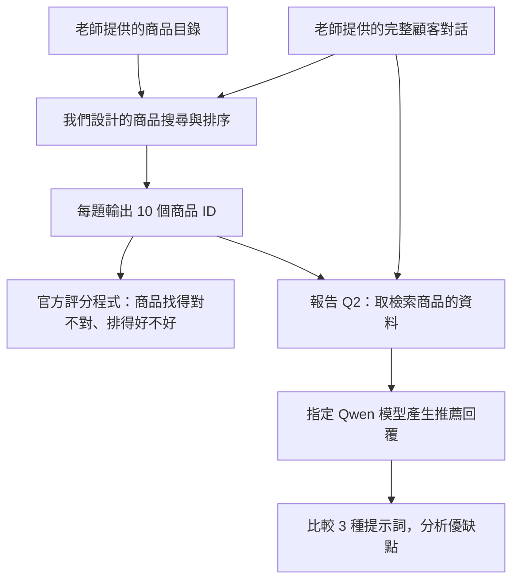

# 這份 HW2 到底在做什麼？

> 給你看的白話說明，2026-10-24 整理。這份不是新的作業規格，也不取代 PROJECT、PLAN 或 PROGRESS；之後實作不需要以它為依據。

**這份作業要你做一個「聽完顧客需求，能從大量商品裡找出合適商品」的系統，再用找出的商品資料，實驗怎麼寫出好的推薦回覆。**

## 先看這個例子

假設對話是：

> 顧客：我想買乳液。之前買過助曬產品。  
> 店員：這次想要什麼效果？  
> 顧客：保濕就好，而且不要香味。

我們應該找「保濕、無香味的乳液」。不能因為對話提到「助曬」，就一直推薦助曬產品；也不能把「不要香味」理解成「喜歡香味」。

老師已經提供對話和商品目錄。**我們要設計的是：怎麼利用整段對話，找出合適商品，並把好的商品排前面。**

## 你其實要完成兩件事

| 工作 | 白話意思 | 最後產生什麼 |
|---|---|---|
| **主要任務：找商品、排順序** | 從幾萬個商品裡，選出最值得推薦的 10 個 | 每段對話的一份「10 個商品 ID 排名」 |
| **報告 Q2：寫推薦回覆** | 把找出的商品資料交給指定模型，讓它回覆顧客，再比較不同提示詞 | 生成內容、提示詞比較與分析 |

商品 ID（PID）就是商品的編號。主要評分程式要看的，是這些編號及排列順序。

Q2 則必須使用 **Qwen2.5-1.5B-Instruct**。作業要求至少 5 個不同樣本、至少 3 種提示詞；我們規劃每個樣本都試 3 種，所以會有 **5 × 3 = 15 份回覆**。15 是我們選的比較方式。

資料中的對話已經寫好了。因此，目前不需要另外做聊天網站、購物車，或讓機器人真的和顧客來回聊天。

## 整個流程長這樣

**RAG 就是「先找資料，再根據資料回答」。**在這份作業裡，搜尋與排名先單獨評分，生成回覆另外放在報告 Q2 做實驗。

還有一個容易混淆的地方：官方評分也會用 Qwen 當「裁判」，判斷你找的商品是否合理。**裁判用的 Qwen，和 Q2 寫回覆的 Qwen，是兩個不同工作。**我們可以設計 Q2 的提示詞，但不能改裁判的規則。

## 哪些可以改？哪些不能改？

最核心的修改位置是：**`retrieval_utils.py` 裡，`retrieve_and_rerank()` 函式的 `STUDENT CODE START` 與 `STUDENT CODE END` 之間。**

你可以把它理解成：老師把「讀題、交答案、改考卷」準備好了，留了一個區域讓我們寫「解題方法」。

| 部分 | 我們能做什麼 |
|---|---|
| `retrieval_utils.py` 的指定區塊 | **可以改。**決定怎麼讀懂需求、表示商品、搜尋、排序，最後回傳結果 |
| 訓練、實驗、分析、Q2 生成腳本 | **可以另外寫。**用來訓練模型、比較方法、分析結果與重現實驗 |
| `README.md`、報告、`run.sh`、`download.sh` | **需要完成。**讓助教知道如何準備模型、重現訓練及理解實驗 |
| `requirements.txt` | 列出實際依賴，仍須配合作業執行環境；不能任意破壞既有環境 |
| `retrieval.py`、`eval_utils.py`、`evaluate.py` | **保留原版。**不修改官方讀取、輸出或評分流程 |
| 輸出格式 | **不能自由換。**正式每題要有 10 個存在、不重複的商品 ID，且不能漏題 |
| 測試答案與測試資料 | **不能拿來作弊或微調。**不能偷讀答案後直接回傳，也不能尋找 private 資料 |

訓練和分析腳本可以獨立建立；正式檢索是否能任意引用額外自訂模組，仍有規則待確認。所以目前把正式檢索邏輯留在指定區塊內。

## 「解題方法」裡，有哪些能自己設計？

下面都是可以研究的方向，**不是每一項都必須加進去**。

| 能設計的部分 | 白話意思 | 例子／目前做法 |
|---|---|---|
| **對話怎麼處理** | 要把哪些資訊交給搜尋模型？怎麼保留前後文？ | 目前保留完整對話與角色；超長時保留開頭和結尾。摘要、需求改寫可另做比較 |
| **商品怎麼表示** | 要讓模型看標題、描述，還是分段處理？ | 目前把標題和描述合起來，一個商品轉成一個向量 |
| **Embedding 模型** | 用哪個模型把文字變成能比較的數字？ | 目前選 BGE-small；這是我們的選型，不是老師強制指定 |
| **搜尋演算法** | 怎麼從所有商品找候選？ | 可研究語意向量搜尋、BM25 關鍵字搜尋，或兩者結合；目前用語意向量 |
| **索引與搜尋工具** | 怎麼存放和比較向量，讓搜尋跑得動？ | 目前用 FAISS 做精確搜尋；它是搜尋工具，不是負責理解文字的模型 |
| **Reranker：再排序** | 先選一批，再逐一細看誰更合適 | 例如先找 50 個，再挑最好的 10 個；目前還沒加 |
| **模型訓練方式** | 怎麼教模型把顧客需求和適合商品配在一起？ | 可以設計正負樣本、loss、學習率等；目前 BGE 尚未經本作業資料微調 |
| **Q2 提示詞** | 怎麼請模型利用商品資料回答？ | 可比較直接推薦、逐項對照需求、明確說明缺少哪些資訊 |

「向量」可以先理解成一串描述文字特徵的數字。Embedding 模型把對話和商品各轉成數字，再用相似度比較。**相似度高不保證真的符合所有條件**，所以還要檢查否定、顏色、用途、改口等錯誤。

如果做訓練，最基本的想法是：「這段對話」應該接近「適合的商品」，遠離「不適合的商品」。Loss 就是告訴模型目前配得有多差，讓訓練能調整參數。不過，資料只標一個答案，其他商品也可能合理，不能草率地把其他所有商品都當成錯的。

**訓練是否一定要做，仍需釐清。**報告 Q1 和 `run.sh` 都要求交代訓練，因此目前的「未微調版本」可以當比較起點，但不能直接宣稱已滿足最終提交要求。

## 我們現在寫的版本，到底在幹嘛？

目前先做一個簡單、能驗證的版本，叫作 **Baseline：後續改善時用來比較的起點**。

1. 把這次收到的所有商品，交給 BGE 轉成向量，保留每個向量對應的商品 ID。
2. 把整段顧客對話也轉成向量，不只看最後一句。
3. 用 FAISS 比較對話與商品的相似度。
4. 把分數較高的商品排前面，回傳前 10 個 ID。
5. 檢查有沒有重複、漏題或不存在的商品。

前兩步中的「整理商品、建索引」就是計畫裡的 **Offline Indexing**；收到對話後「搜尋、排序」就是 **Online Retrieval**。這裡是在區分工作內容，不代表我們要架兩個網路服務。目前每次正式執行會針對當次商品池重建索引。

現在沒有額外的重排模型，也沒有讓 LLM 幫每個查詢改寫需求。要先量測這個起點的問題在哪裡，再決定哪種改善值得做。

## 為什麼前面一直在切資料、做測試？

因為「程式會跑」和「商品推薦得好」是兩件都要驗證的事。

| 工作 | 在確認什麼 |
|---|---|
| 切 train／dev | 一部分用來學習，另一部分當模擬考，避免只記住練習題 |
| 把重複內容放同一邊 | 避免練習題和模擬考其實有相同內容，造成分數虛高 |
| 檢查 PID 對應 | 避免模型找到乳液，程式卻回傳成洗髮精的編號 |
| 檢查多輪與截斷 | 避免漏掉一開始的用途，或最後一句「不要香味」 |
| 小型真模型測試 | 確認實際模型和官方入口真的能一起運作 |
| 完整 dev 評估 | 確認搜尋方法在大量真實商品中到底好不好 |

我們把原始 4,830 段訓練對話切成 **3,864 段 train + 966 段 dev**。這是切「練習與驗證的對話」，**商品候選仍保留完整 50,000 個**。

截至這份說明：W00～W05 已推進到小型檢索整合測試通過；其中 W01 的 Qwen 驗證仍待做。已有 12 個單元測試通過、兩次小型真模型執行結果一致。**完整 dev/public 品質評估、Q2 生成與最終封裝還沒完成。**

下一步 W06 才要回答：「在完整商品池裡，我們到底找得多準、跑得多快？」

## 怎樣才算做得好、做完了？

官方主要看兩件事：

- **Recall@10：**有多少段對話，在前 10 個推薦裡至少找得到一個可接受商品。
- **MRR@10：**第一個可接受商品排多前面。排第一比排第十好。

可接受商品包含標註的答案，也包含官方裁判認為合理的替代品。因此不是只能找到唯一那個商品，也不是把 10 個推薦全部命中才算成功。

商品池會從 train 的 **5 萬**，擴大成 public 的 **7.5 萬**、private 的 **10 萬**。所以最終目的是：**遇到新的對話和新增商品時，仍能把符合需求的商品找出來、排前面，並用商品資料寫出有根據的回覆。**

還要跑得動：public 檢索有 **1 小時**限制，官方 GPU 是 **8 GB VRAM**；我們這台較強電腦跑得快，不代表官方環境一定達標。

最後要交的不只是一份排名，還包括：

- **檢索程式與必要模型的下載方式。**
- **重現用的程式、`run.sh`、`download.sh`、套件清單與 README。**其中 `run.sh` 用於重現訓練；`download.sh` 只負責下載，不能偷放安裝或訓練步驟。
- **報告 Q1：**說清楚方法、訓練設計、參數、比較結果與選擇理由。
- **報告 Q2：**用指定模型做生成實驗，比較提示詞，分析成功和失敗案例。
- **依規定整理成小寫學號資料夾與 ZIP。**

你看目前進度時，可以抓住這個區別：**我們已經把「找商品的基本機器」接起來了，接下來要驗證它找得好不好，再完成回覆實驗和可交付的作業。**

---

本說明根據本地作業文件及目前程式整理，沒有新增作業規則。需要查細節時：規定見 [PROJECT.md](C:/Users/yuting/Desktop/HW2_ADL/PROJECT.md)，方法見 [PLAN.md](C:/Users/yuting/Desktop/HW2_ADL/PLAN.md)，實際進度見 [PROGRESS.md](C:/Users/yuting/Desktop/HW2_ADL/PROGRESS.md)。
